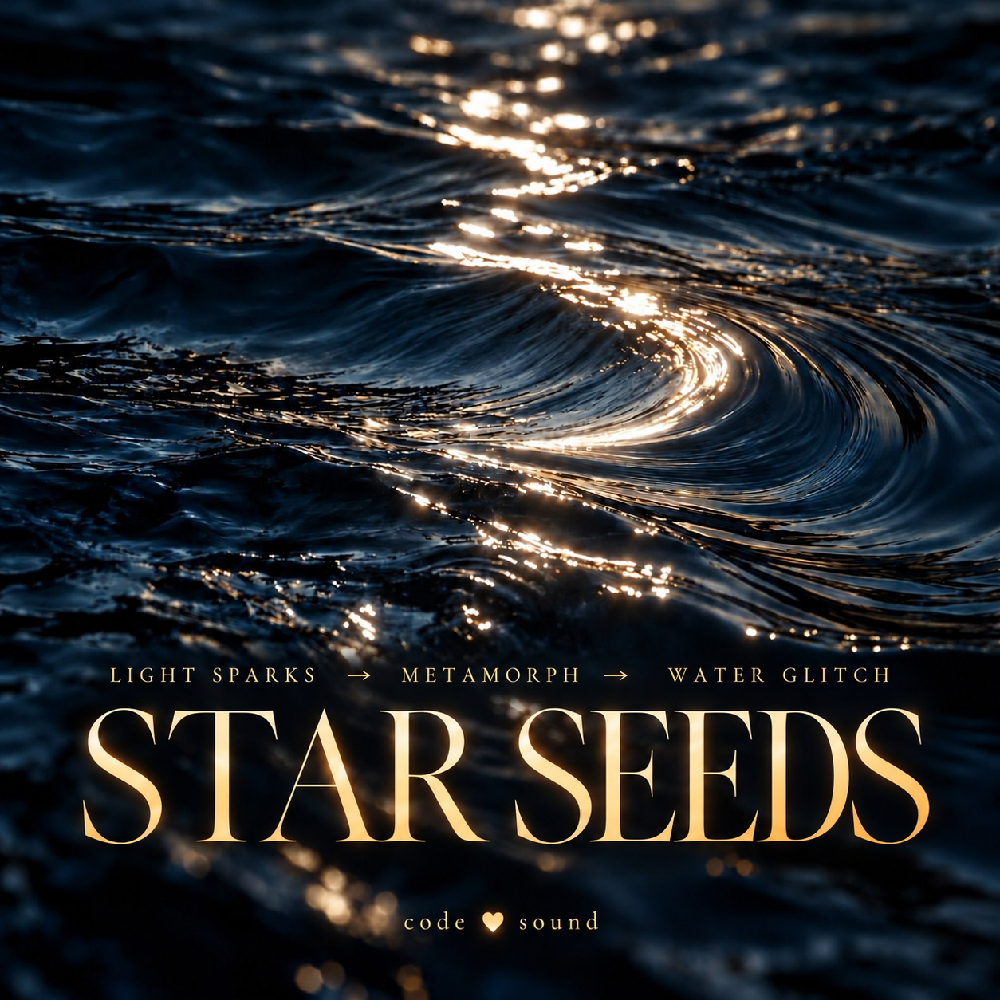

# Logic Recordings

Музыкальные произведения Снежаны, созданные в Logic Pro. У каждого трека — своя папка с аудио (когда оно есть) и краткой карточкой для будущего авторского разбора. Это отдельный проект, не часть [Live Coding](https://github.com/yogasnow/live-coding).

**Повторяемый маршрут:** [от собственных нот к учебному коду](COMPOSITION-TO-CODE.md) → [шаблон](templates/new-composition/README.md) → [план произведения 04](tracks/04-next-composition/README.md).

**Сейчас в работе:** [Warm Fog / Cycle I — паспорт проекта](tracks/04-next-composition/README.md). Добавлены паспорт от 30 октября и авторская ссылка на SoundCloud; исходники и аудиофайлы этой выгрузкой не добавлены.

**Предыдущий цикл:** [Water Glints — запись, партитура и открытый код](tracks/03-water-glints/README.md). Материалы сохранены для возвращения к аранжировке и дополнительным партиям.

| Произведение | Аудио | Карточка |
| --- | --- | --- |
| Am Dialogue — Leitmotif Mix 01 | [MP3 · 1:19](tracks/01-am-dialogue/audio.mp3) | [Открыть](tracks/01-am-dialogue/README.md) |
| Velvet and Sky — Three Minute Ascent | [MP3 · 3:03](tracks/02-velvet-and-sky/audio.mp3) | [Открыть](tracks/02-velvet-and-sky/README.md) |
| Атастин / Water Glints — «Блик на воде» | [MP3 · 4:00](tracks/03-water-glints/audio.mp3) | [Паспорт, проект Logic и партитуры](tracks/03-water-glints/README.md) |
| Warm Fog / Cycle I | [SoundCloud](https://on.soundcloud.com/n107quVRbQOH7SuTMX) | [Паспорт проекта](tracks/04-next-composition/PASSPORT.md) |
| Warm Fog / Cycle II | [SoundCloud](https://soundcloud.com/karmasnow/warm-fog-cycle-ii) | [Описание и состояние проекта](tracks/04-next-composition/cycle-ii/README.md) |

**Открытый TypeScript:** [аранжировка по нотным событиям](music-code/README.md) · [права на код](CODE-LICENSE.md). Для Water Glints уже работает на подтверждённых событиях; для двух ранних записей подготовлены карточки ввода нот без вымышленной транскрипции.

В карточках оставлены поля для авторского объяснения: форма, размер и ритм, знаки альтерации, гармония и аккорды по тактам. Пока нет партитуры или проекта Logic, эти музыкальные решения не утверждаются по одному MP3.

Три доступных MP3 можно слушать и скачать; отдельная лицензия на переработку или коммерческое использование не предоставлена. Для Атастин / Water Glints опубликованы проект Logic, рабочие ноты PDF и MusicXML, MIDI и исходники синтеза. Звук редактируется в Logic Pro, ноты — в совместимом нотном редакторе.
