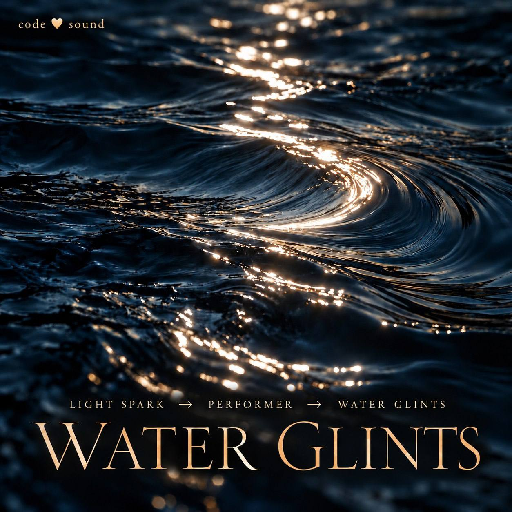

# Атастин / Water Glints — «Блик на воде»

Полный паспорт и история работы, редакция от 27 октября 2026 года.

**Авторский замысел и музыкальные решения:** Снежана. **Материалы этой редакции:** кодовый синтез, нотная редакция и проект Logic Pro. Это инструментальная работа; слова о чтении хоровых партитур означали навык чтения многоголосных нот, а не заказ хора SATB.

## Всё произведение в одной папке

- [Слушать и скачать MP3](audio.mp3) — готовый микс, 320 кбит/с, около 4 минут.
- [Скачать проект Logic Pro, ZIP 110 МБ](https://github.com/yogasnow/logic-recordings/releases/download/atastin-logic-v1/Atastin-Logic-Only.zip) — только .logicx со встроенными WAV и MIDI.
- [Паспорт PDF](Atastin-Passport.pdf).
- [Полная рабочая нотная редакция PDF](scores/Atastin-Reading-Score.pdf) — 37 страниц A3.
- [Флейта: чтение с листа, PDF](scores/Atastin-Flute.pdf) — 2 страницы A4.
- [MusicXML полной партитуры](scores/Atastin-Reading-Score.musicxml) и [флейты](scores/Atastin-Flute.musicxml).
- [Редактируемый MIDI](scores/Atastin-64-Editable.mid), [карта тактов](data/bars.json), [исходник аудиосинтеза](source/render_audio.py).

Проект Logic физически хранится во вложении Release этого же репозитория. В папке находятся все остальные материалы и ссылка на него. Большой ZIP не дублируется в Git-истории. Архив после скачивания нужно распаковать вручную.

## Паспорт произведения

| Поле | Зафиксированное решение |
| --- | --- |
| Название | Атастин; рабочие имена Water Glints, «Блик на воде», Vinyl Flight |
| Редакция | Последняя версия с плотным басом, 27.10.2026 |
| Форма | 64 музыкальных такта и хвост затухания |
| Длительность | WAV 239.804 с; MP3 около 239.830 с |
| Тональность | Ре минор; краткие хроматические соседи без постоянной смены тонального центра |
| Тоническое трезвучие | D-F-A: ре-фа-ля |
| Лейтмотив | A-F: ля-фа, нисходящая большая терция; возвращение к терции тоники |
| Украшение | Трель на F: F-G с возвращением к F |
| Доминанта | A7: A-C#-E-G; разрешение в Dm |
| Хроматика | Eb-D и Ab-A как намеренное трение и разрешение |
| Размеры | 4/4, 6/8, 5/4; полный порядок приведён ниже |
| Ритмическая идея | Пропуски, ранние/поздние акценты, дробление; намерение 3+3+2 внутри 4/4 и 3+2 / 2+3 в 5/4 |
| Темповая основа | Adagio: четверть = 66 |
| Largo | Такты 40-41: четверть = 50 |
| Рост | 39-й = 68; после Largo 42-й = 71.75, далее до 79.25 в 48-м |
| Rubato | Такты 49-56: 68, 62, 66, 58, 64, 60, 56, 60 четвертей в минуту |
| Возвращение Adagio | С 57-го: четверть = 66 |
| Характер | Dolce; окраска Grazioso; манера Cantabile |
| Динамический замысел | Основной уровень mf; отступления к mp, p и pp, мягкий спад |
| Диапазон будущего голоса | Обсуждались примерно 2.5 октавы, точные крайние ноты не проверены; вокал не записан |

BPM в технической карте означает четверти в минуту также в 6/8. Rubato текущей реализации задано изменениями между тактами; свободное исполнительское дыхание внутри фраз ещё можно уточнять. Динамические буквы обозначают замысел и нотную редакцию, а не измеренную громкость каждого аудиотакта.

## Состав и устройство проекта Logic

11 непустых аудиослоёв: виниловые стрелы; стеклянная мелодия с блокфлейтовыми красками; бархатистая перкуссия; арфа; воздушные гармоники; флейта; глич; пальцевый бас; тихий саб; глухая бочка; уду и щелчки. Тембры синтезированы, живой звук и хор не записывались. Старый пустой Warm Foundation заменён новым низким ансамблем и в проект не переносился.

В Logic сохранены 11 аудиодорожек, 10 MIDI-дорожек и один пустой начальный аудиоканал. Аудио звучит, MIDI по умолчанию приглушены для предотвращения удвоения. Чтобы менять ноты, отключите соответствующий аудиослой, включите его MIDI и выберите тембр. Звучание штатных патчей Logic отличается от процедурного синтеза. При импорте Logic добавил басовым MIDI-регионам октавную компенсацию +12 под свои патчи; при смене патча проверяйте звучащую октаву. Отдельный MIDI сохраняет исходные высоты событий.

Все 11 WAV находятся внутри .logicx. Их PCM-сэмплы проверены на совпадение с исходными слоями. MIDI содержит 1587 извлечённых нотных и ударных событий по всем слоям; шумовые/пространственные эффекты полностью передаются аудио, а не только MIDI. Проект включает карту темпов, размеров и маркеры формы. Граница проекта оставляет место хвосту затухания после 64-го музыкального такта.

## Форма и драматургия

| Такты | Движение и вступления | Динамический замысел |
| --- | --- | --- |
| 1-2 | Виниловые стрелы: напряжение, расширение, парение | mp |
| 3-4 | Звонкая мелодия; с 4-го глухая перкуссия и новый низкий ансамбль | mp-mf |
| 5-7 | Смещённый грув; в 6-м первая намеренная ошибка Eb-D | mf |
| 8-12 | Арфа выходит вперёд; опевание опор, сбой в 10-м | mf, фон мягче |
| 13-16 | Флейтовая окраска, подготовка диалога, A7-Dm | mf |
| 17-20 | Соло флейты и ответы арфы; Dm-Dm-Gm-A7 | mf |
| 21-24 | Фа-капля, трель; паузы и отражения, возвращение в Dm | mf-mp |
| 25-28 | Ломаный рисунок, пропуски, дробление, хроматический ответ | mf-mp |
| 29-32 | Блик блокфлейты A-F; доминанта и удержание фа | mf-mp |
| 33-39 | Арфа отдыхает, флейтовые ответы, постепенный сбор машинного грува | mp-mf |
| 40-41 | Largo: звенящая пустота, фа флейты, арфовые блики; новый низ молчит | p, раскрытие |
| 42-48 | Постепенный возврат плотного низа, рост регистра и яркости; разрешение в 48-м | к mf |
| 49-56 | Rubato: A-F рассыпается между тембрами, низ плавно отступает | mf-p |
| 57-64 | Adagio, без бочки; фрагменты мотива и тоническое послевкусие | p-pp |

40-41 — выбранная художественная точка раскрытия пространства; 48-й — вершина разрешения. Образ золотого сечения использовался при обсуждении, но математическое совпадение по времени не утверждается.

## Потактовая карта текущего рендера

| Такт | Размер | Четверть BPM | Аккорд | Начало, с |
| --- | --- | --- | --- | --- |
| 1 | 4/4 | 66 | Dm | 0.000 |
| 2 | 4/4 | 66 | Dm | 3.636 |
| 3 | 4/4 | 66 | Bb | 7.273 |
| 4 | 4/4 | 66 | A7 | 10.909 |
| 5 | 4/4 | 66 | Dm | 14.545 |
| 6 | 4/4 | 66 | Gm | 18.182 |
| 7 | 5/4 | 66 | A7 | 21.818 |
| 8 | 4/4 | 66 | Dm | 26.364 |
| 9 | 5/4 | 66 | Dm | 30.000 |
| 10 | 4/4 | 66 | Gm | 34.545 |
| 11 | 4/4 | 66 | A7 | 38.182 |
| 12 | 6/8 | 66 | Dm | 41.818 |
| 13 | 6/8 | 66 | Bb | 44.545 |
| 14 | 4/4 | 66 | Gm | 47.273 |
| 15 | 5/4 | 66 | A7 | 50.909 |
| 16 | 4/4 | 66 | Dm | 55.455 |
| 17 | 4/4 | 66 | Dm | 59.091 |
| 18 | 4/4 | 66 | Dm | 62.727 |
| 19 | 6/8 | 66 | Gm | 66.364 |
| 20 | 6/8 | 66 | A7 | 69.091 |
| 21 | 5/4 | 66 | Dm | 71.818 |
| 22 | 6/8 | 66 | Bb | 76.364 |
| 23 | 4/4 | 66 | A7 | 79.091 |
| 24 | 4/4 | 66 | Dm | 82.727 |
| 25 | 4/4 | 66 | Dm | 86.364 |
| 26 | 4/4 | 66 | Gm | 90.000 |
| 27 | 4/4 | 66 | A7 | 93.636 |
| 28 | 4/4 | 66 | Dm | 97.273 |
| 29 | 4/4 | 66 | Dm | 100.909 |
| 30 | 4/4 | 66 | Bb | 104.545 |
| 31 | 4/4 | 66 | A7 | 108.182 |
| 32 | 4/4 | 66 | Dm | 111.818 |
| 33 | 6/8 | 66 | Dm | 115.455 |
| 34 | 6/8 | 66 | Dm | 118.182 |
| 35 | 4/4 | 66 | Bb | 120.909 |
| 36 | 4/4 | 66 | Gm | 124.545 |
| 37 | 5/4 | 66 | Dm | 128.182 |
| 38 | 4/4 | 66 | Gm | 132.727 |
| 39 | 5/4 | 68 | A7 | 136.364 |
| 40 | 4/4 | 50 | Dm | 140.775 |
| 41 | 4/4 | 50 | Dm | 145.575 |
| 42 | 4/4 | 71.75 | Dm | 150.375 |
| 43 | 6/8 | 73 | Bb | 153.720 |
| 44 | 5/4 | 74.25 | Gm | 156.186 |
| 45 | 4/4 | 75.5 | Dm | 160.227 |
| 46 | 5/4 | 76.75 | Gm | 163.405 |
| 47 | 4/4 | 78 | A7 | 167.314 |
| 48 | 4/4 | 79.25 | Dm | 170.391 |
| 49 | 5/4 | 68 | Dm | 173.419 |
| 50 | 6/8 | 62 | Bb | 177.831 |
| 51 | 4/4 | 66 | Dm | 180.734 |
| 52 | 5/4 | 58 | Gm | 184.371 |
| 53 | 6/8 | 64 | Dm | 189.543 |
| 54 | 4/4 | 60 | Bb | 192.356 |
| 55 | 5/4 | 56 | A7 | 196.356 |
| 56 | 4/4 | 60 | Dm | 201.713 |
| 57 | 4/4 | 66 | Dm | 205.713 |
| 58 | 6/8 | 66 | Bb | 209.349 |
| 59 | 4/4 | 66 | Gm | 212.076 |
| 60 | 5/4 | 66 | Dm | 215.713 |
| 61 | 4/4 | 66 | A7 | 220.258 |
| 62 | 4/4 | 66 | Dm | 223.895 |
| 63 | 4/4 | 66 | Dm | 227.531 |
| 64 | 4/4 | 66 | Dm | 231.167 |

## История работы и обучения

1. Автор задала образ винилового пробуждения, переменный метр, звонкость, бархатистый ритм и солирующую арфу. Выбран ре минор как предварительная тональная основа.
2. Создан исходный эскиз на 32 такта. В нём обсуждался фа мажор; в новой форме закреплено сохранение ре минора. Раннюю версию сохранили отдельно.
3. По обратной связи добавлены сознательные нарушения: разрывы, пропущенные удары, хроматические соседи с разрешениями. Подготовлен отдельный фрагмент 1-16.
4. Определён поэтапный маршрут развития формы и музыкального языка.
5. В тактах 17-24 разработан диалог флейты и арфы; выбрано долгое фа. Автор закрепила мотив ля-фа как узнаваемое зерно, трель на фа, Dolce, Grazioso, Cantabile и основной mf.
6. Согласованы 64 такта, три размера, Largo 40-41, rubato 49-56, Adagio с 57-го, подъём к 48-му и мягкое завершение. Подготовлен рендер.
7. После прослушивания автору не хватило плотности. Добавлены пальцевый бас с тихим сабом, глухая бочка, уду и щелчки; низ молчит в 40-41 и постепенно уходит с 49-го.
8. Созданы WAV и MP3. Для простого обмена готовой музыкой достаточно MP3 около 9.6 МБ; проект нужен для редактирования.
9. Первый PDF содержал паспорт и план формы. После уточнения о чтении с листа извлечены реальные события, подготовлены MIDI, рабочая нотная редакция, MusicXML и отдельная флейтовая партия.
10. Создан и сохранён настоящий проект .logicx, перенесены WAV и MIDI, отключено дублирующее воспроизведение. Подготовлены отдельные архивы проекта и полного пакета.
11. Проект опубликован во вложении Release репозитория logic-recordings. Теперь все материалы доступны из одной папки, устаревшие записи «ещё не получены» заменены актуальными.

## Почему передача заняла лишние шаги

Ассистент недостаточно рано разделил три результата: готовый аудиотрек, редактируемый проект и читаемые ноты. MP3 уже существовал, пока продолжалась работа над исходниками и партитурой. Первый PDF был планом, а не нотной записью. Изначально выдавались локальные ссылки, неудобные для внешнего обмена. Кроме того, актуальная 64-тактовая версия сначала была кодовым аудиорендером и только позднее собрана как native-проект Logic.

Правильный короткий маршрут: сначала MP3 для прослушивания; параллельно отдельный проект Logic для изменений; нотные материалы как самостоятельный результат. Для большого ZIP выбран Release: это позволяет получить одну внешнюю ссылку без деления архива и без дублирования тяжёлого файла в Git-истории. Никакой защитный механизм не обходился.

## Границы точности

- Паспорт различает авторский замысел и текущую реализацию. В рендере местами сохраняются дополнительные арфовые и звонкие фигуры; не все обсуждённые паузы буквально отредактированы.
- Рабочая нотная редакция округляет длительности до читаемой сетки, сокращает пересекающиеся хвосты до следующей атаки и заменяет дробные повторы трели знаком tr. Точный исходный тайминг сохранён в MIDI и events.json.
- Это многопартийная инструментальная нотная редакция, не хоровое переложение и не окончательно выверенная исполнительская партитура. Дыхание, лиги, артикуляция и часть голосоведения требуют ручной проверки.
- Полный слуховой аудит звучания в исполнении Logic не заявляется. Подтверждены состав и сохранение проекта, встроенные WAV, совпадение PCM и отсутствие цифрового клиппинга исходного WAV.
- Отдельная открытая лицензия на переработку и коммерческое использование пока не назначена. Публичность файлов сама по себе такой лицензией не является.

## Что улучшить

1. Сверить 40-48 и 49-64 на слух: настоящую пустоту, плавность входа низа и нежность спада.
2. Уточнить, где свободное дыхание нуждается в более плавной темповой кривой вместо текущих ступеней между тактами.
3. Проверить сцену баса и бочки на колонках и в наушниках, а также в моно; сохранить паузы, не наращивая низ непрерывно.
4. Вручную отредактировать нотную запись по фразам: дыхание флейты, артикуляцию арфы, группировку 5/4, запись перкуссии и связь tr с реально звучащим украшением.
5. По очереди заменить выбранные синтезированные слои тембрами Logic, сохраняя исходную версию для сравнения.

## Предлагаемая работа на 28 октября

- Сначала вместе прослушать 40-48 и 49-64; автор выбирает 2-3 конкретных места для правки.
- Сделать отдельную альтернативу проекта и поправить баланс баса/бочки, паузы и темповое дыхание.
- Прочитать и пропеть флейтовую партию, затем уточнить её лиги, интервалы и трель на фа в MusicXML.
- Сохранить новую версию и сразу выдать MP3 для обратной связи; затем обновить нотные файлы и Release при необходимости.

Это план продолжения, не назначенная автоматическая задача. Музыкальное решение остаётся за автором.

## Проверки файлов и воспроизведение кода

Проектный ZIP проверен на целостность. Его SHA-256: `2f6e61083bb2203530796f79f1dca3a70165656671349ffe4f2710360faef2e1`.

В [source/render_audio.py](source/render_audio.py) находится исходник процедурного синтеза. Для запуска нужны Python 3 и numpy: `python3 source/render_audio.py`. Скрипт создаёт WAV, папку Stems и карту рядом с собой; готовый MP3 размещён отдельно. Реестр файлов: [manifest.json](manifest.json).
