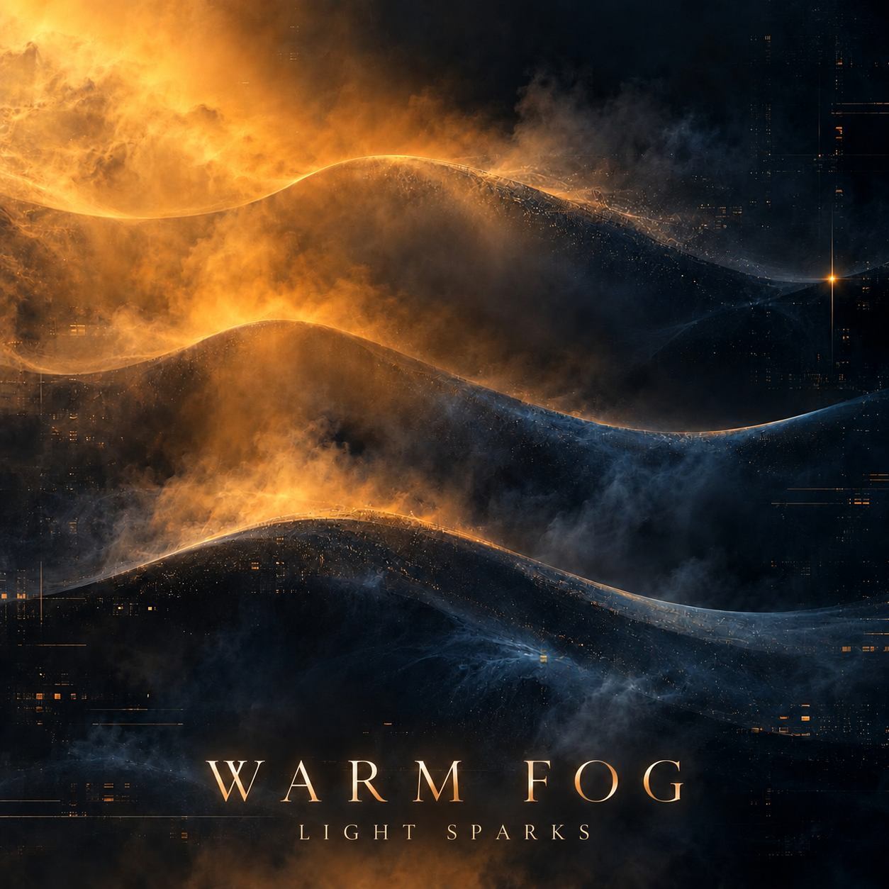

# Warm Fog · пространственный ambient / glitch

**Актуально на 31 октября 2026:** [Warm Fog / Cycle I на SoundCloud](https://on.soundcloud.com/n107quVRbQOH7SuTMX) · [паспорт проекта от 30 октября](PASSPORT.md) · [PDF](Warm-Fog-Project-Passport-2026-10-30.pdf).

Паспорт фиксирует 170 BPM, 4/4, G♯ minor, форму 136 тактов и три редакции. Исходный проект и аудиофайлы этой выгрузкой не добавлены. Ниже сохранён исторический замысел от 28 октября; предложенные тогда параметры не заменяют данные актуального паспорта.

## Циклы

- [Cycle I — паспорт и ссылка на запись](PASSPORT.md).
- [Cycle II — запись на SoundCloud и состояние полного проекта](cycle-ii/README.md).
- [Cycle III — ансамблевая динамика и будущая мастерская Logic + TypeScript](cycle-iii/README.md).

## Звуковой замысел · 28 октября 2026

Пространственный ambient с элементами IDM и мерцающими волновыми сбоями, короткими обрывами и паузами между долями. Ритмический слой соединяет ломаную синкопу и тяжёлый шаг trip-hop с редкими ровными импульсами и щелчками microhouse. Внизу — ясная басовая линия; выше — дымчатые клавиши и меняющийся глитч-узор. Музыка должна позволять следить слухом за развитием ритма, а не скрывать его эффектами.

Это описание направления, не утверждение о готовом звуке или выбранной тональности.

## Первая сессия в Logic · предлагаемый эскиз

1. Создать новый проект с рабочим темпом **88 BPM** и размером **4/4**; оба параметра можно пересмотреть после первого прослушивания. Сохранить исходный проект.
2. Сделать 8 тактов с четырьмя дорожками: **основной пульс**, **синкопированные щелчки/перкуссия**, **бас**, **пространственная клавишная фактура**. Пока не заполнять все паузы.
3. Такты 1–4: устойчивый ритмический и басовый мотив. Такты 5–6: одна слышимая смена синкопы или тембра. Такт 7: короткий обрыв. Такт 8: возврат пульса. Глитч и вспышки добавлять только после того, как базовый рисунок узнаётся без них.
4. Экспортировать короткий WAV/MIDI-эскиз и записать: где пульс понятен, где синкопа спотыкается намеренно, где низ перегружает фактуру. Не объявлять этот план готовой партитурой.

**Первый учебный фокус:** записать один басовый мотив на 1–2 такта и прослушать его с ударными без клавиш и эффектов. Затем изменить одну паузу или смещение ноты и сравнить ощущение движения.

## 1. Авторский замысел и первые ноты

Снежана задаёт название или рабочий образ, записывает собственный мотив на 1–4 такта и отмечает размер, темп, паузы и знаки альтерации. Сначала сохраняем исходную нотную версию; код не заменяет её.

## 2. Проверенные музыкальные данные

Короткий фрагмент сохраняется как фото нот, MIDI, MusicXML или проект Logic. Указываем партии и диапазоны тактов. Если есть только аудио, точную запись нот не объявляем восстановленной автоматически.

## 3. Первый учебный код

Переносим подтверждённые события в [`score.json`](score.json). Для первой задачи используем [TypeScript-инструмент аранжировки](../../music-code/README.md); JavaScript или Python добавляем только когда для них есть конкретная учебная цель. Сначала проверяем 1–4 такта, затем расширяем произведение.

## 4. Сверка и развитие

Открываем созданный MIDI в Logic или нотном редакторе, сравниваем высоту, ритм и длительности с авторским фрагментом. Отдельно пробуем сменить тембр, не меняя мелодию. Записываем, что совпало с нотами, что изменено как аранжировка и что требует исправления.

## 5. Выпуск учебной версии

В карточке произведения размещаем авторский паспорт, проверенные ноты/MIDI или MusicXML, запускаемый код, инструкцию и звуковой пример, когда он готов. Промежуточные материалы отмечаем как эскиз; финальный мастер — только после авторской проверки. Права на музыку и обложку обозначаем отдельно от лицензии кода.

**Ближайшее действие:** авторский нотный фрагмент 1–4 такта с темпом и размером. После него заполним первую версию этой карточки и проверим код на реальной мелодии.

## Проверенная исходная сессия

[Первая сессия ABSYNTH 6 — настройки и учебные шаги](SESSION-2026-10-28-ABSYNTH.md). Сохранена отдельная учебная копия Logic с патчем Nice; фактическая сетка сейчас 170 BPM, 4/4. Рабочий образ-предложение: «Шаг сквозь туман». Полный трек ещё не создан.

[Warm Fog — авторские решения 28 октября и предложенное развитие на 12 тактов](WARM-FOG-2026-10-28.md).
